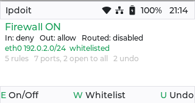
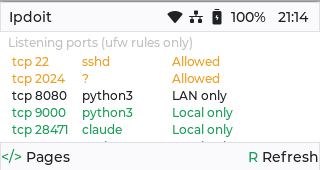

<p align="center">
  
  
</p>

<div align="center">
    <h1>Ipdoit for CardputerZero</h1>
    <p>Manage the UFW firewall from the CardputerZero launcher.</p>
</div>

## What it does

- **Status**: firewall on/off, default policies, the current network and whether it is
  whitelisted.
- **Rules**: the ufw rule list in match order; delete the selected rule; add rules with a
  form (presets for SSH, HTTP, HTTPS, DNS, mDNS) or by typing ufw syntax. Every new rule is
  checked with `ufw --dry-run` before it is applied.
- **Ports**: everything listening (`ss -tulpn`) plus ports that only have rules, each with a
  switch: Enter cycles **Blocked > LAN > Allowed** and applies at once (U undoes). Blocked is
  the default; LAN is My network (whitelisted only); `*` means another rule decides more.
- **My network** rules follow the device: they use the current subnet, and are rewritten
  when the network changes. Each is either *whitelisted only* (active only on networks you
  whitelisted, identified by gateway MAC) or *any network*.
- **SSH is allowed by default**: turning the firewall on, or installing the package, adds
  `limit 22/tcp` (or sshd's port) if nothing else allows it.
- **Safety**: rule changes are shown before they are applied; an SSH lockout guard warns
  (Enter twice to override) when a change would block sshd; Undo restores the rules from
  before the last change (it never turns the firewall on or off).
- **sudo password** asked on launch, kept in memory only.

See [docs/REQUIREMENTS.md](docs/REQUIREMENTS.md) for scope, design decisions and planned
features.

## Keys

| Page | Keys |
| --- | --- |
| all main pages | `Left`/`Right` switch pages, `R` refresh, `Esc` quit |
| Status | `E` firewall on/off, `W` whitelist this network, `U` undo |
| Rules | `Up`/`Down` select, `A`/`Enter` add with form, `T` type a rule, `D`/`Del` delete |
| Ports | `Up`/`Down` select, `Enter` Blocked > LAN > Allowed, `U` undo |
| Networks | `Up`/`Down` select, `Enter` toggle current network, `D` remove from whitelist |
| Add rule | `Up`/`Down` field, `Tab`/`Shift`+`Tab` change choice (on a text field: next field), `1`-`5` preset, `Enter` check |
| Confirm | `Enter` apply (twice when there is a warning), `Esc` cancel |

`Fn`+`H` shows help for the current page. Hold `Esc` to quit.

## How it works

- The app runs as your user. Every privileged step goes through one root helper,
  `/usr/libexec/ipdoit/ipdoit-helper`, run with `sudo`. It takes `/run/ipdoit.lock`, backs
  up the rules, runs ufw, and re-syncs My network rules.
- The firewall state is read in one helper call: `ufw status verbose`, the rule tuples from
  `/etc/ufw/user.rules` and `user6.rules`, `ss -tulpn`, and `ip addr/route/neigh`.
- Deleting finds the rule's current number by its tuple inside the lock, so a rule number
  that shifted in the meantime is never deleted.
- My network rules are kept as templates in `/etc/ipdoit/mynet-rules.conf`; the live ufw
  rules carry an `ipdoit:mynet:<id>` comment. A NetworkManager dispatcher hook
  (`/etc/NetworkManager/dispatcher.d/90-ipdoit`) re-syncs them when a connection changes,
  and the app does too when it opens. If the gateway's MAC is not known yet (just
  connected), existing whitelisted-only rules for that network are kept until it is.
- Undo backups (last 10) are in `/var/lib/ipdoit/backups/`.
- Port verdicts follow ufw's own rules only; rules added outside ufw (`before.rules`, raw
  iptables/nftables) are not evaluated.

## Helper commands

For use over SSH (as root):

```shell
ipdoit-helper state
ipdoit-helper dry-run allow from 192.168.1.0/24 to any port 22 proto tcp
ipdoit-helper add limit 22/tcp
ipdoit-helper mynet-add allow tcp 8080 whitelisted dev server
ipdoit-helper whitelist-add gw:aa:bb:cc:dd:ee:ff 192.168.1.0/24 Home
ipdoit-helper sync
ipdoit-helper undo
```

## Installed files

| Path | Purpose |
| --- | --- |
| `/usr/bin/ipdoit-for-cardputer-zero` | the app (started by the launcher) |
| `/usr/libexec/ipdoit/ipdoit-helper` | root helper |
| `/etc/NetworkManager/dispatcher.d/90-ipdoit` | re-syncs My network rules on network changes |
| `/etc/ipdoit/whitelist.conf`, `mynet-rules.conf` | whitelist and My network templates |
| `/var/lib/ipdoit/backups/` | undo backups |

Depends on `ufw`, `sudo` and `iproute2`. There is no systemd service. Removing the package
takes the live My network rules out of ufw; purging also deletes `/etc/ipdoit` and the
backups.

## Screenshots

The page screenshots come from the desktop simulator.
`screenshot/ipdoit-launcher-mockup.png` is a mockup, not a capture: it places the Ipdoit
icon on the launcher home screen using the carousel geometry from
[CardputerZero/launcher](https://github.com/CardputerZero/launcher)'s source. The Store icon
and carousel arrows in it are that project's assets (MIT, Copyright (c) 2026 M5Stack
Technology CO LTD). The launcher's top bar is left blank, and the titles use DejaVu Sans
Bold rather than the launcher's Montserrat.

## Status

Tested on an Ubuntu 24.04 amd64 host with a live ufw (IPv4; the sandbox had no IPv6) and a
real sshd, in the desktop simulator as a sudo user: password, all four pages, add by form
and by typing, delete, SSH guard and override, undo, whitelist on/off, firewall on/off,
My network sync on network change, and install/remove/purge of the package. The package
passes AppBuilder's root-service check.

**Not yet tested on CardputerZero hardware.** Things to check there: that the image ships
ufw with working netfilter, that it uses NetworkManager, the device keyboard for passwords
and typed rules, and IPv6.

## Build Options

Common CMake cache options:

| Option | Default | Description |
| --- | --- | --- |
| `USE_DESKTOP` | `ON` | Build SDL desktop simulator when `ON`; build embedded Linux target when `OFF`. |
| `APP_NAME` | `ipdoit-for-cardputer-zero` | Application name used by installed asset lookup. |
| `APP_ASSETS_ROOT` | empty | Optional runtime asset root. Expected layout includes `fonts/`, `images/`, etc. |
| `APP_CONFIG_FILE` | platform default | Optional config path. Defaults to `config/ipdoit-for-cardputer-zero.conf` for desktop builds and `/etc/ipdoit-for-cardputer-zero.conf` for device builds. |
| `APP_KEY_INPUT_DEVICE` | empty | Optional Linux evdev device path, e.g. `/dev/input/event0`. Empty means auto-scan `/dev/input/event*`. |
| `APP_FRAMEBUFFER_DEVICE` | `/dev/fb0` | Linux framebuffer device used by embedded builds when `APP_USE_DRM=OFF`. |
| `APP_USE_DRM` | `OFF` | Use LVGL's Linux DRM/KMS backend instead of fbdev for embedded builds. |
| `APP_DRM_DEVICE` | `/dev/dri/card0` | DRM device path used when `APP_USE_DRM=ON`. |
| `APP_DRM_CONNECTOR_ID` | `-1` | DRM connector id used when `APP_USE_DRM=ON`; `-1` auto-selects. |

Asset lookup order:

1. `APP_ASSETS_ROOT` when provided by CMake
2. source-tree `assets/` for development
3. `/usr/share/<APP_NAME>/` for installed deployments

Theme startup behavior is configured in `config/ipdoit-for-cardputer-zero.conf`:

```ini
[application]
dark_mode=yes
```

Set `dark_mode` to `yes` or `no`. The parser also accepts `true`/`false` and `1`/`0`.
Installed device builds use `/etc/ipdoit-for-cardputer-zero.conf` as the system default. Changing the theme
from the navigation bar (keyboard shortcut `6`) writes a per-user override to
`$XDG_CONFIG_HOME/ipdoit-for-cardputer-zero/ipdoit-for-cardputer-zero.conf`, or `~/.config/ipdoit-for-cardputer-zero/ipdoit-for-cardputer-zero.conf`
when `XDG_CONFIG_HOME` is not set. The per-user file takes precedence on the next launch.

## Desktop Builds

Desktop builds are intended for fast UI development. LVGL renders at the device-native `320x170` resolution, while SDL composites that texture into a hardware-accelerated, high-DPI simulator window with the full-resolution device shell.

Current dependencies info:

| Dependency | Version | Source | Notes |
| --- | --- | --- | --- |
| LVGL | `v9.5.0` | `CMakeLists.txt` FetchContent | Main GUI framework. |
| fmt | `12.1.0` | System package manager or `vcpkg.json` override | Logging and formatted strings. |
| libpng | `1.6.48` | System package manager or `vcpkg.json` override | PNG image decoding support for LVGL. |
| libjpeg-turbo | `3.1.3` | System package manager or `vcpkg.json` override | JPEG image decoding support for LVGL. |
| zlib | `1.3.1` | System package manager or `vcpkg.json` override | Compression dependency used by image libraries. |
| SDL2 | `2.32.54` | System package manager or `vcpkg.json` override | Desktop simulator display and input backend. |
| FreeType | `2.13.3` | System package manager or `vcpkg.json` override | Runtime TTF font rendering. |

> Windows vcpkg installs use the versions above through manifest mode, with the registry baseline pinned in `vcpkg-configuration.json`.

### Linux Desktop

Debian/Ubuntu dependencies:

```shell
sudo apt update
sudo apt install -y \
  build-essential \
  cmake \
  ninja-build \
  libpng-dev \
  libjpeg-dev \
  libfmt-dev \
  libsdl2-dev \
  libfreetype-dev \
  zlib1g-dev
```

> [!NOTE]
> Minimal CMake version is 3.31.0 (in coordinate with Debian 13 trixie), for Ubuntu user you can install latest cmake via `snap`
> and run following cmake command with `/snap/bin/cmake`.


Configure:

```shell
cmake --preset linux-x86-64
```

Build:

```shell
cmake --build --preset linux-x86-64-dbg
# alternatively, you can run release build
# cmake --build --preset linux-x86-64-rel
```

Run:

```shell
./build/linux-x86-64/Debug/ipdoit-for-cardputer-zero
# or launch release build
# ./build/linux-x86-64/Release/ipdoit-for-cardputer-zero
```

### macOS Desktop

Install the Apple command-line tools:

```shell
xcode-select --install
```

Install dependencies with Homebrew:

```shell
brew install \
  cmake \
  ninja \
  libpng \
  jpeg \
  fmt \
  sdl2 \
  freetype \
  dpkg \
  zlib
```

Configure for Apple Silicon:

```shell
cmake --preset darwin-arm64
```

Build:

```shell
cmake --build --preset darwin-arm64-dbg
# alternatively, you can run release build
# cmake --build --preset darwin-arm64-rel
```

Run:

```shell
./build/darwin-arm64/Debug/ipdoit-for-cardputer-zero
# or launch release build
# ./build/darwin-arm64/Release/ipdoit-for-cardputer-zero
```

For Intel macOS, use the `darwin-x86-64` configure preset and matching build preset:

```shell
cmake --preset darwin-x86-64
cmake --build --preset darwin-x86-64-dbg
# alternatively, you can run release build
# cmake --build --preset darwin-x86-64-rel
./build/darwin-x86-64/Debug/ipdoit-for-cardputer-zero
# or launch release build
# ./build/darwin-x86-64/Release/ipdoit-for-cardputer-zero
```

### Windows Desktop

Install CMake and Ninja:

```powershell
winget install Kitware.CMake
winget install Ninja-build.Ninja
```

Install a C++ toolchain. Choose one of the following.

MSVC Build Tools:

```powershell
winget install Microsoft.VisualStudio.BuildTools
```

In the Visual Studio installer, enable **Desktop development with C++** and make sure MSVC and a Windows SDK are selected.

MinGW-w64:

```powershell
winget install BrechtSanders.WinLibs.POSIX.UCRT
```
Alternatively, you can download from [`winlibs`](https://winlibs.com/). 

Install vcpkg:

```powershell
git clone https://github.com/microsoft/vcpkg.git C:\vcpkg
C:\vcpkg\bootstrap-vcpkg.bat -disableMetrics
```

Configure environmental variables for current terminal:

```
$env:VCPKG_ROOT="C:\vcpkg"
$env:PATH="$env:VCPKG_ROOT;$env:PATH"
```

> [!TIP]
> Change `VCPKG_ROOT` to your vcpkg installation directory if it is located elsewhere.
>
> These environment variables are **session-scoped**, meaning they only apply to the current terminal session.
> Once the terminal is closed, the variables will be lost and need to be set again in a new session.
> If you want to a persist environment variable
> ```powershell
> setx VCPKG_ROOT "C:\vcpkg"
> ```


Configure and build with MSVC:

> [!IMPORTANT]
> These steps require launching CMake from a **Developer Command Prompt** or **Developer PowerShell** provided by Visual Studio.
>
> This ensures that the MSVC environment (compiler, linker, and Windows SDK paths) is properly initialized.
>
> Without this environment setup, CMake may fail to detect or correctly configure the MSVC toolchain.

```powershell
cmake --preset win32-msvc
cmake --build --preset win32-msvc-dbg
.\build\msvc\Debug\ipdoit-for-cardputer-zero.exe

# alternatively for release build
# cmake --build --preset win32-msvc-rel
# .\build\msvc\Release\ipdoit-for-cardputer-zero.exe
```

Configure and build with MinGW-w64:

> [!IMPORTANT]
> These steps require a properly configured MinGW-w64 toolchain in your system PATH.
>
> Please ensure the following compilers are available in the current terminal session:
> - gcc
> - g++
> - ld
> - ar
>
> You can verify the setup by running:
> ```powershell
> gcc --version
> g++ --version
> ```
>
> If these commands are not recognized, you must add MinGW-w64 `bin` directory to your PATH before configuring CMake.

```powershell
cmake --preset win32-mingw64
cmake --build --preset win32-mingw64-dbg
.\build\mingw64\Debug\ipdoit-for-cardputer-zero.exe

# alternatively for release build
# cmake --build --preset win32-mingw64-rel
#.\build\mingw64\Release\ipdoit-for-cardputer-zero.exe
```
> [!NOTE]
> `VCPKG` will handle the dependencies during CMake configuration process automatically, 
> this may take several minutes depend on you network connection.

## CardputerZero Cross Build

This preset builds an aarch64 Linux target from a host machine with an `aarch64-linux-gnu-gcc/g++` toolchain.
The BSP at `.cache/sdk_bsp-src` is treated as a sysroot: headers, libraries, startup objects, and pkg-config metadata are resolved from that directory first.
If that directory does not exist on the first configure, the toolchain downloads and extracts `sdk_bsp.tar.gz` automatically before CMake runs compiler checks.

Install a cross compile toolchain:

+ Debian

```shell
sudo apt install crossbuild-essential-arm64
```
+ MacOS

```shell
brew install aarch64-unknown-linux-gnu
```

> [!NOTE]
> On Windows, it's recommended to use WSL for cross build
> or you can download [cross compile tools](https://sysprogs.com/getfile/2542/raspberry64-gcc14.2.0.exe) and configure the `PATH` yourself

Configure:

```shell
cmake --preset cp0-cross
```

Build:

```shell
cmake --build --preset cp0-cross-dbg
# or release build
# cmake --build --preset cp0-cross-rel
```

Deploy the release package to your device after filling in your device user and IP:

```shell
REMOTE_USER=<user> REMOTE_HOST=<device-ip> ./deploy.sh
```

By default, the debian package is copied to '$HOME' folder, normally it's under '/home/\<user\>'.

On your device, install the copied package with `apt` and replace the package file name with the one you copied:

```shell
sudo apt install --no-install-recommends ./ipdoit-for-cardputer-zero_v<version>_arm64.deb
```


## Development Guide

### Adding a Screen

1. Add a new page enum value in `src/model/base_model.h`.
2. Add the page transition/state logic in `BaseModel` and `BaseViewModel`.
3. Create a screen under `src/view/screens/` deriving from `BaseScreen`.
4. Extend `ScreenManager` to load the new screen when the page subject changes.
5. Update `NavBar` icons and callbacks as needed.

### Adding a Widget

1. Derive from `BaseWidgets`.
2. Implement `build()` and create LVGL objects under `parent_`.
3. Use `reactive::bind_*` helpers for text, style, state, or event bindings.
4. Keep LVGL observer lifetimes object-bound whenever possible with `lv_subject_add_observer_obj` or `reactive::observe_obj`.

### Fonts and Assets

Device builds use Noto Sans CJK Medium for the default bold text and Noto Sans CJK Regular for regular-weight text. They are loaded through FreeType from:

```text
/usr/share/fonts/opentype/noto/NotoSansCJK-Medium.ttc
/usr/share/fonts/opentype/noto/NotoSansCJK-Regular.ttc
```

When either system font is unavailable, the UI falls back to LVGL's built-in Montserrat fonts. Desktop builds always use the fallback fonts. Runtime icon and other asset fonts remain under:

```text
assets/fonts/
/usr/share/<APP_NAME>/fonts/
```

You can also provide an asset root at configure time:

```shell
cmake --preset darwin-arm64 -DAPP_ASSETS_ROOT=/path/to/assets
```


## Debian Package

Debian packages are produced with CPack and written to `dist/`. The package file name follows:

```text
<package-name>_v<Version>_arm64.deb
```

Default example:

```text
dist/ipdoit-for-cardputer-zero_v<version>_arm64.deb
```

Package layout:

| Path | Content |
| --- | --- |
| `/usr/bin/ipdoit-for-cardputer-zero` | Application executable. |
| `/etc/ipdoit-for-cardputer-zero.conf` | System-default application settings, including the startup theme. |
| `/usr/share/ipdoit-for-cardputer-zero/` | Runtime assets: fonts, images, audio. |
| `/usr/share/APPLaunch/applications/ipdoit-for-cardputer-zero.desktop` | APPLaunch launcher entry. |
| `/usr/share/APPLaunch/share/images/ipdoit-for-cardputer-zero*.png` | APPLaunch launcher icons/fallbacks. |
| `/usr/lib/systemd/system/ipdoit-for-cardputer-zero.service` | Optional systemd service for embedded autostart. |
| `/usr/share/doc/ipdoit-for-cardputer-zero/` | README and third-party asset license notes. |

Build and package:

```shell
cmake --preset cp0-cross
cmake --build --preset cp0-cross-rel
cpack --preset cp0-cross-deb
```

Or run the full configure, release build, and package flow with one workflow preset:

```shell
cmake --workflow --preset cp0-cross-package
```

> [!NOTE]
> Use Debian based Linux host with CPack generator 
> as other OS may not resolve the dependencies correctly
> no full dpkg, dpkg-shlibdeps, objdump and readelf support

# Contributing

If you have better framework designs on Embedded Linux or build system practice, feel free to let us know.

# License

Project released under MIT license. More license information can be found in assets folder. 
